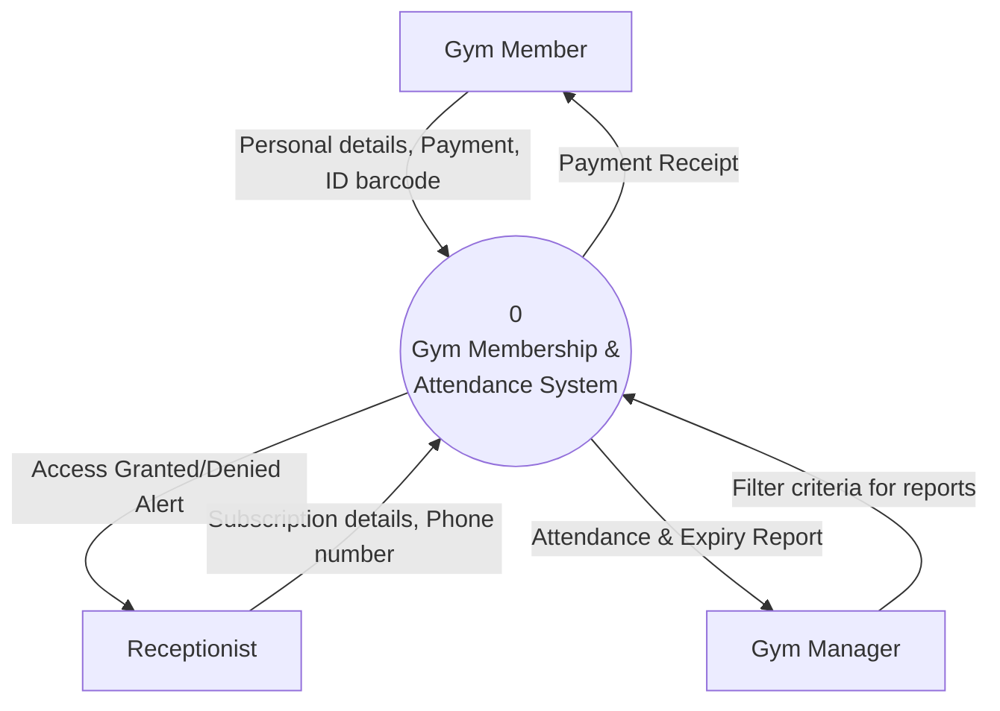
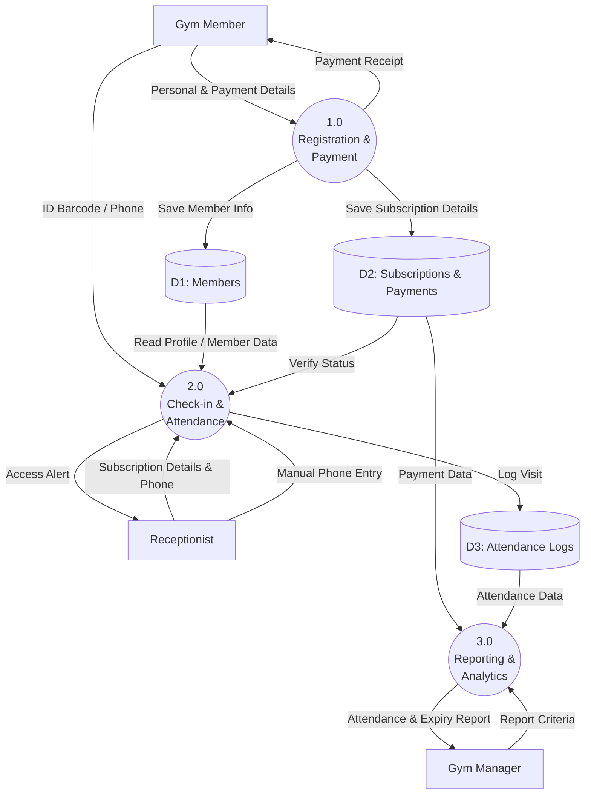

# Gym Membership & Attendance System

## 1. System Name and Problem

| Property | Details |
| :--- | :--- |
| **System name** | Gym Membership and Attendance System |
| **Part of (domain)** | Fitness and Sports Club Domain |
| **Problem** | Gyms struggle to manually track expired memberships, and members lose motivation because their attendance and commitment are not tracked. |
| **How the system solves it** | The system manages subscription dates, logs daily check-ins using ID cards to track member commitment, and alerts the reception when a membership is expired. |

---

## 2. Users

| User | What they do in the system |
| :--- | :--- |
| **Receptionist** | Registers new members, inputs payment details, renews subscriptions, and monitors the check-in screen. |
| **Gym Member** | Scans their ID card to enter the gym and registers their daily visit. |
| **Gym Manager** | Views reports on active memberships, expired accounts, and daily attendance metrics. |

---

## 3. System Components

| Component | What it does |
| :--- | :--- |
| **Registration & Payment Module** | Records member personal details, subscription types, and processes payment data. |
| **Check-in & Attendance Module** | Scans member ID cards, verifies subscription validity, and logs the daily visit. |
| **Reporting Module** | Generates lists of expired memberships and member commitment/attendance summaries. |

---

## 4. System Inputs

### Primary Inputs
| Input | Details |
| :--- | :--- |
| **Member ID barcode** | Scanned at the reception desk to log a visit |
| **Subscription & Payment details** | Duration, type, and payment amount entered during new registration |

### Substitute Inputs
| Substitute input | Used instead of / when |
| :--- | :--- |
| **Member phone number typed by hand** | Barcode scanner is broken or the member forgot their ID card |

### Environmental Inputs
| Environmental input | Why it is needed |
| :--- | :--- |
| **Barcode Scanner** | Needed to quickly read member ID cards for the Check-in Module |
| **Wi-Fi / Internet Connection** | Connects the gym's devices to the central database |
| **Desktop Computer** | Used by the receptionist to run the Registration Module |

---

## 5. System Outputs

| Output | Goes to | Form |
| :--- | :--- | :--- |
| **Payment Receipt** | Gym Member | Printed / Email |
| **Access Granted/Denied Alert** | Receptionist | Screen |
| **Attendance & Expiry Report** | Gym Manager | Screen / Printed |

---

## 6. Source and Sink

| Entity | Source (gives) | Sink (receives) |
| :--- | :--- | :--- |
| **Gym Member** | Personal details & Payment amount | Payment Receipt |
| **Receptionist** | Member phone number (manual input) | Access Granted/Denied Alert |
| **Gym Manager** | Filter criteria for reports | Attendance & Expiry Report |

---

## 7. Context Diagram

## 8. DFD Level 0 Diagram

